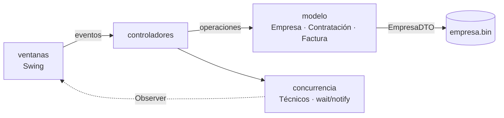

<h1 align="center">🛡️ Sistema de Monitoreo de Seguridad</h1>

<p align="center">
  Aplicación de escritorio en <b>Java</b> para una empresa de monitoreo: gestión de abonados, contratación de servicios de seguridad, facturación y asignación concurrente de técnicos.
</p>

<p align="center">
  
  
  
  
</p>

---

## 📌 Sobre el proyecto

Trabajo final de **Programación III** (Ingeniería Informática, UNMdP). Modela una empresa que vende servicios de seguridad para **viviendas y comercios**: botones antipánico, cámaras y móviles de acompañamiento.

El objetivo era aplicar **patrones de diseño**, **arquitectura MVC**, **persistencia** y **concurrencia** en un sistema completo con interfaz gráfica.

## ✨ Funcionalidades

- 🔐 **Registro e inicio de sesión** de abonados (personas físicas o jurídicas)
- 🏠 **Contratación de servicios** por domicilio, para vivienda o comercio, con botones, cámaras y móvil
- 🎁 **Promociones** Dorada y Platino aplicadas sobre cada contratación
- 🧾 **Facturación mensual**, con facturas pendientes y pagadas
- 💳 **Métodos de pago** (efectivo, cheque o tarjeta), cada uno con su recargo o descuento
- ⚠️ **Estados del abonado**: sin contratación, con contratación o moroso, con reglas distintas en cada caso
- 👷 **Visitas técnicas concurrentes**: los abonados esperan a que haya un técnico libre y la ventana se actualiza en tiempo real
- 💾 **Persistencia** del estado completo de la empresa en un archivo binario

## 🧩 Patrones de diseño aplicados

| Patrón | Dónde |
| --- | --- |
| **Singleton** | `Empresa`: un único punto de acceso al sistema |
| **Factory** | `PersonaFactory`, `ContratacionFactory`, `FacturaFactory`, `PromocionFactory` |
| **Decorator** | `DecoratorEfectivo`, `DecoratorCheque`, `DecoratorTarjeta` sobre la factura |
| **State** | `SinContratacionState`, `ConContratacionState`, `MorosoState` |
| **Observer** | `Tecnicos` (Observable) → `Observador_Tecnicos` actualiza la vista |
| **DTO** | `EmpresaDTO` para serializar y restaurar el sistema |
| **MVC** | paquetes `modelo` / `ventanas` / `controladores` |

## 🏗️ Arquitectura



## 📁 Estructura

```
src/main/java/
├── com/mycompany/Main.java   # punto de entrada: restaura el estado y abre el login
├── modelo/                   # dominio, patrones y persistencia
├── controladores/            # lógica de cada ventana
├── ventanas/                 # interfaz gráfica (Swing)
├── concurrencia/             # pool de técnicos con wait/notify + Observer
└── util/
```

## 🚀 Cómo ejecutarlo

Requisitos: **JDK 8+** y **Maven**.

```bash
git clone https://github.com/ignacantando/sistema-monitoreo-seguridad-java.git
cd sistema-monitoreo-seguridad-java
mvn compile exec:java -Dexec.mainClass=com.mycompany.Main
```

También se puede abrir como proyecto Maven en NetBeans, IntelliJ o Eclipse y correr `com.mycompany.Main`.

## 👤 Autor

**Ignacio Cantando Flego** · [LinkedIn](https://www.linkedin.com/in/ignacio-cantando-flego-8ba84a127/) · [GitHub](https://github.com/ignacantando)
